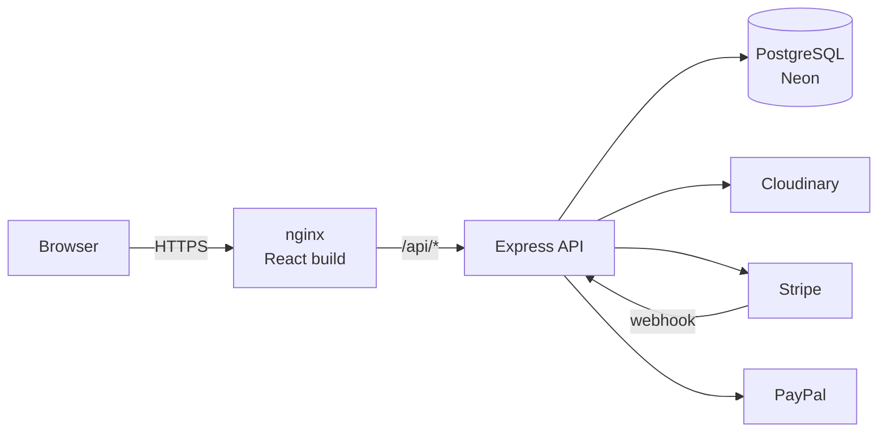
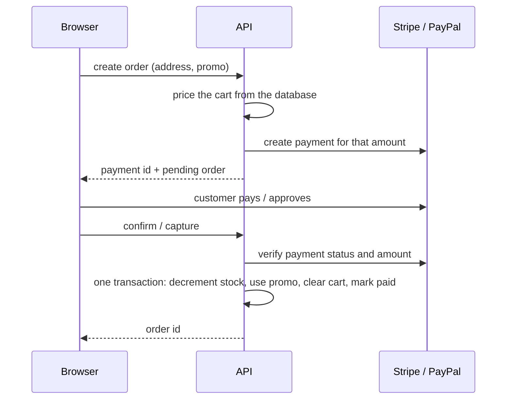

# PERN E-Commerce

[](https://github.com/skycode9/PERN-Ecommerce/actions/workflows/ci.yml)

A full-stack clothing store with a customer storefront and an admin panel. Built with
PostgreSQL, Express, React and Node, with Stripe and PayPal payments, custom JWT auth with Google
sign-in, and Docker images deployed on Render.

**Live demo:** https://pern-ecom.onrender.com

| Account                | Email                    | Password      |
| ---------------------- | ------------------------ | ------------- |
| Customer               | `demo@example.com`       | `DemoPass123` |
| Admin (read-only)      | `admin.demo@example.com` | `DemoPass123` |

Payments run in test mode. Use card `4242 4242 4242 4242` with any future expiry and any CVC, or
a PayPal sandbox buyer account. The demo is on Render's free tier, so the first request after a
while can take up to a minute while the services wake up.


## Features

**Storefront**

- Home page with banners, categories, latest products and live promos
- Collection page with category, brand, color and size filters
- Product details with image gallery, color/size options and related products
- Guest cart in local storage that merges into the account cart on sign-in
- Wishlist, saved addresses and order history
- Returns within a window after delivery, refunded as reward points
- Checkout with card (Stripe), PayPal, or reward points, plus promo codes

**Admin panel**

- Dashboard with total sales, orders, returns, products and categories
- Product and category management with multi-image upload to Cloudinary
- Order management with status updates (placed, shipped, delivered, returned)
- Promo codes with usage limits, minimum order value and date windows
- Home page banners: upload, replace and delete, with images cleaned up on Cloudinary

**Auth**

- Email/password and Google sign-in
- Short-lived access token kept in memory, refresh token in an httpOnly cookie
- Refresh tokens are stored hashed and rotated on every use

## Tech stack

| Layer     | Tools                                                                         |
| --------- | ----------------------------------------------------------------------------- |
| Frontend  | React 19, TypeScript, Vite, Tailwind CSS v4, shadcn/ui, Zustand, React Router |
| Backend   | Node 22, Express 5, TypeScript, Zod, Winston                                  |
| Database  | PostgreSQL on Neon, Prisma ORM                                                |
| Auth      | JWT (HS256), bcrypt, Google Identity Services                                 |
| Payments  | Stripe Payment Intents + webhooks, PayPal Orders API                          |
| Media     | Cloudinary                                                                    |
| DevOps    | Docker, nginx, Docker Compose, Render, GitHub Actions                         |
| Tooling   | ESLint, Prettier, Husky, lint-staged                                          |

## Architecture



The React app and the API are served from the same origin: nginx serves the static build and
proxies `/api/*` to the Express service. Because the browser only ever talks to one domain, the
refresh cookie can stay `SameSite=Strict`.

### Checkout flow



- Totals are always computed on the server from database prices. The client never sends an
  amount.
- Stripe orders are also confirmed by a signed webhook, so an order is marked paid even if the
  browser closes before the confirm call. Finalizing an order is idempotent, so the confirm call
  and the webhook can both arrive safely.
- PayPal captures are checked for `COMPLETED` status and an exact amount match before the order
  is finalized.
- Stock is decremented with a conditional update inside the transaction, so two buyers cannot
  both take the last item.

### Security

- `helmet`, `hpp`, a 10kb JSON body limit and CORS restricted to known origins
- Global rate limit, plus a stricter one on login, register, Google and refresh
- Generic auth errors so emails cannot be enumerated
- Access tokens expire in 15 minutes and pin the signing algorithm
- Errors are logged on the server; clients only get a generic message
- The demo admin can open every admin page, but any write returns `403`

## Project structure

```
.
├── client/                 React app
│   ├── src/
│   │   ├── components/     ui primitives, layouts, admin and customer components
│   │   ├── features/       api calls, stores and types per feature
│   │   ├── pages/          route pages
│   │   └── lib/            api client, env, helpers
│   ├── nginx/              nginx config template used by the image
│   └── Dockerfile
├── server/                 Express API
│   ├── prisma/             schema, migrations, seed
│   ├── src/
│   │   ├── routes/         auth, customer and admin routers
│   │   ├── middleware/     auth guards, error handling
│   │   └── utils/          envelope, errors, payments, uploads, logger
│   └── Dockerfile
├── postman/                API collection
├── docker-compose.yml
└── render.yaml
```

Every endpoint replies with the same envelope:

```json
{ "status": "success", "data": {}, "meta": {} }
{ "status": "error", "data": null, "errors": [{ "message": "Cart is empty", "code": "APP_ERROR" }] }
```

## Running locally

You need Node 22+, a PostgreSQL database (a free [Neon](https://neon.tech) project works), and
test keys for Cloudinary, Stripe, PayPal and Google OAuth.

```bash
git clone https://github.com/skycode9/PERN-Ecommerce.git
cd PERN-Ecommerce

# api
cd server
cp .env.example .env          # fill in the values
npm install
npx prisma migrate deploy
npx prisma db seed            # demo products, banners, promo and demo accounts
npm run dev                   # http://localhost:8080

# web, in a second terminal
cd client
cp .env.example .env
npm install
npm run dev                   # http://localhost:5173
```

### With Docker

```bash
docker compose --env-file client/.env up --build
```

The app is then available at http://localhost:8080, with nginx in front of the API exactly as in
production.

### Environment variables

**server/.env**

| Name                                                               | Description                                          |
| ------------------------------------------------------------------ | ---------------------------------------------------- |
| `PORT`                                                             | API port (default `8080`)                            |
| `CORS_ORIGINS`                                                     | Comma-separated allowed origins                      |
| `TRUST_PROXY`                                                      | Number of proxies in front of the API                |
| `DATABASE_URL` / `DIRECT_URL`                                      | Pooled and direct Postgres connection strings        |
| `JWT_SECRET`                                                       | Secret for signing access tokens                     |
| `GOOGLE_CLIENT_ID`                                                 | Google OAuth client id                               |
| `ADMIN_EMAILS`                                                     | Emails that get the admin role on sign-up            |
| `DEMO_ADMIN_EMAIL`                                                 | Admin account that is read-only                      |
| `CLOUDINARY_CLOUD_NAME` / `CLOUDINARY_API_KEY` / `CLOUDINARY_API_SECRET` | Image uploads                                  |
| `STRIPE_SECRET_KEY` / `STRIPE_WEBHOOK_SECRET`                      | Stripe API key and webhook signing secret            |
| `PAYPAL_CLIENT_ID` / `PAYPAL_CLIENT_SECRET` / `PAYPAL_ENV`         | PayPal app credentials, `sandbox` or `live`          |

**client/.env**

| Name                          | Description                                       |
| ----------------------------- | ------------------------------------------------- |
| `VITE_BACKEND_URL`            | API base url (`/api` in the Docker image)         |
| `VITE_GOOGLE_CLIENT_ID`       | Google OAuth client id                            |
| `VITE_STRIPE_PUBLISHABLE_KEY` | Stripe publishable key                            |
| `VITE_PAYPAL_CLIENT_ID`       | PayPal client id (the button is hidden if empty)  |
| `VITE_DEMO_MODE`              | `true` shows demo logins and test card hints      |

## Deployment

The repo includes a [Render Blueprint](render.yaml) with two Docker web services:

1. **pern-ecom-api** runs `prisma migrate deploy` on start and then the API.
2. **pern-ecom** is nginx serving the React build and proxying `/api` to the API service.

Steps:

1. In Render, choose **New → Blueprint** and select this repository.
2. Fill in the secret values. Set `API_UPSTREAM` on the web service to the API's public url and
   `CORS_ORIGINS` on the API to the web service's url.
3. In Google Cloud, add the web url to the OAuth client's authorized JavaScript origins.
4. In Stripe, add a webhook endpoint at `https://<api-url>/customer/checkout/webhook` for
   `payment_intent.succeeded`, then copy its signing secret into `STRIPE_WEBHOOK_SECRET`.
5. Seed the database once from your machine with `npx prisma db seed`.

## API collection

A Postman collection with every endpoint is in [`postman/`](postman).

## License

[MIT](LICENSE)
